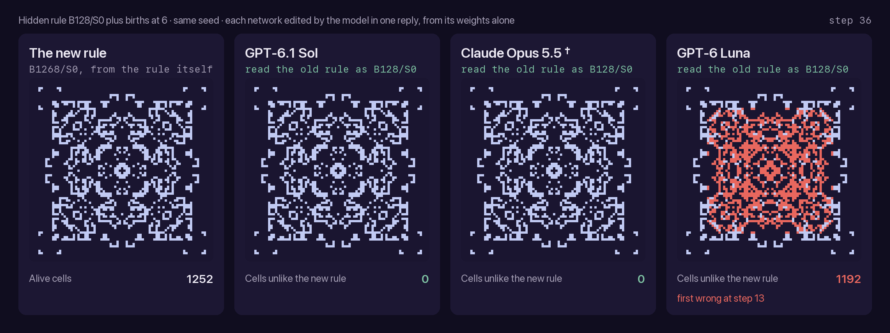
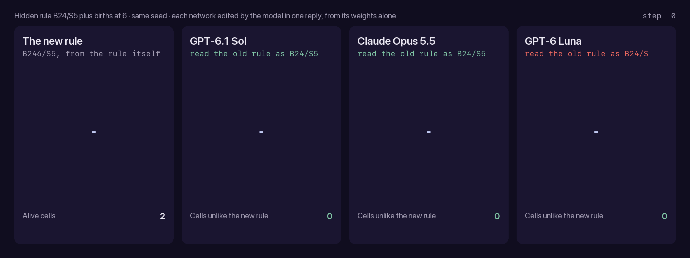

# [WSPlore] Follow-up Explorations of Weight-Space Programming

Follow-up experiments to *Sparks of Weight-Space Programming*: how well language models read, write and edit
neural-network weights directly, without training.

In the original work (Takehi, Teoh, Zhang and Khattab, MIT CSAIL, November 2026), GPT-6 Astra names the task of a
network from its weights, writes working networks from scratch and edits networks to change what they do. The
experiments here so far:

1. **Writing.** Astra writes a Breakout network that scores about 500. If other models are given Astra's own
   explanation of that network, taken from its answer, can they write it too, and where do they fail?
2. **Reading.** How much of the weight-reading result can a model get from a crude summary of one layer?
3. **Editing.** Does a correct edit show that the model read the network? A new task, a small convolutional network
   that runs a cellular automaton, where every way to edit without reading can be found and closed.

<p align="center">
  
</p>

*Given a trained network that runs a cellular automaton, each model is asked to change one rule. GPT-6.1 Sol and
Claude Opus 5.5 succeed; GPT-6 Luna fails (red: cells unlike the new rule). † Task worded as a change of rule.*

## Contents

- [Findings](#findings)
- [Writing weights: give the model Astra's own explanation](#writing-weights-give-the-model-astras-own-explanation)
- [Reading weights: the footprint baseline](#reading-weights-the-footprint-baseline)
- [Editing weights: one rule inside a cellular automaton](#editing-weights-one-rule-inside-a-cellular-automaton)
- [Running it](#running-it)
- [Reproduction](#reproduction)
- [Acknowledgements](#acknowledgements)
- [Licence](#licence)

## Findings

### [1] Writing: Astra's own explanation of its network is enough for other models to rebuild it, move for move

- In the authors' logs, Astra's Breakout answer opens with a short explanation of its design (60 words), then gives
  the weights. We took that explanation out of the answer and added it to the authors' prompt. GPT-6.1 Sol (3 of 3
  runs) and Claude Opus 5.5 (1 of 1) then wrote networks that pick the same move as Astra's network in 99.6–100% of
  19,783 game states, and score 442–503 (Astra's network: 503).
- The weights are their own. At most 1 of the 85–131 weight statements in each answer is identical to one of
  Astra's.
- This crosses model families. Given nothing from Astra, Claude Opus 5.5 already arrives at the same design by itself
  (same move in 95% of states). Given Astra's explanation, it also stops running out of output: both runs finish,
  where two of three without it ran out of their 128k-token limit before writing any weights.
- Weaker models cannot use the explanation. GPT-6 Luna's networks pick Astra's move in 64–78% of states and still
  lose the ball after 60–220 steps on average (scores 0–14). Claude Opus 4.5 scores lower with the explanation than
  without it.
- Where a network differs from Astra's matters more than how often. Sol's own networks, written without Astra's
  explanation, pick Astra's move in only 78–79% of states and still score 378–480: in the 3,108 states where the ball
  is about to land, they always pick Astra's move.

### [2] Reading: naming a network's game needs only arithmetic, not understanding

- We replaced the weights in the authors' Experiment 1 prompt with one number per input: the mean absolute
  first-layer weight, laid out on the game's 10 × 10 grid. Claude Opus 4.5 names the game in 8 of 12 runs from this
  footprint, against 5 of 20 from the full weights (one-sided Fisher p = 0.025).
- The footprint works because it shows where the network looks: the bottom row for Breakout's paddle, the left
  column for Pong's, the maze for Pac-Man. Computed from shuffled weights it shows nothing, and Opus 4.5 falls to
  2 of 12 (p = 0.018). Claude Opus 5.5 names all four games from it.
- The shortcut has a limit. On Experiment 2 (which shape a generator draws), the per-pixel average gives no gain
  (6/9 against 8/15 from the weights), and Opus 4.5 calls the square a disc every time.

### [3] Editing: a correct edit proves little while a shortcut exists; with every shortcut closed, Sol and Opus 5.5 still get it exactly right

- A new task: a small convolutional network (89 weights) runs a cellular automaton, and the model must change one of
  its rules and keep everything else. Every answer is checked on all 512 possible inputs.
- With an easy shortcut open, every model succeeds. Told the rule, Claude Opus 5.5 rebuilt the network from scratch;
  given spare channels, all four models solved both networks (8 of 8), mostly by patching in a detector that works
  without the rule.
- With every shortcut closed, the edit needs the hidden rule. GPT-6.1 Sol and Claude Opus 5.5 read it and edited
  exactly on 4 of 4 networks. GPT-6 Luna managed 1 of 4; where it misread the rule, its network is wrong in exactly
  the cases it misread.

## Writing weights: give the model Astra's own explanation


*Each network was written by the model in one reply, given the authors' Breakout prompt plus the explanation of the
design taken from Astra's own answer. Same episode, same seed. A red frame marks a step where the network's most likely move
differs from what Astra's network would do in that state.*

The task is the authors' Experiment 5 on Breakout: write all 20,486 weights of a 600-32-32-6 tanh policy for
MinAtar Breakout in one reply, with no tools and no feedback. The network is scored over 1,000 episodes with sampled
actions and sticky actions (10,000-step cap). We add part of Astra's own answer to the prompt:

| Level | Prompt |
|---|---|
| L0 | The authors' prompt, unchanged |
| L1 | Plus the explanation that opens Astra's answer, 60 words ([specs/astra_breakout_strategy.txt](specs/astra_breakout_strategy.txt)) |
| L2 | Plus the layout of Astra's edits block with every value removed ([specs/astra_breakout_wiring.txt](specs/astra_breakout_wiring.txt)) |

The **same-move rate** of a network is the share of game states in which its most likely move (left, right or stay)
is the move Astra's network picks. The states are 19,783 states from 30 episodes of Astra's own play, every 10th
step. Moves other than left and right count as stay.

Breakout score per run, with the same-move rate in brackets:

| Model | L0 | L1 | L2 |
|---|---|---|---|
| GPT-6.1 Sol (n=3) | 480, 603, 378 (78%, 95%, 79%) | 503, 503, 503 (100% each) | 503, 503, 503 (100% each) |
| Claude Opus 5.5 | 336, –, – (95%)¹ | 442 (99.6%) | 456 (100%) |
| GPT-6 Luna (n=3) | 6, 0, 3 (21%, 15%, 17%) | 6, 7, 5 (74%, 78%, 78%) | 0, 14, 11 (28%, 73%, 64%) |
| Claude Opus 4.5 | 1.6, 10.7, 2.5, 1.3, 1.0 (21–35%)¹ | 0.5 (21%) | 0.1 (12%) |

¹ L0 runs from Turing's repository (same prompt). – = the model used its whole output limit before writing any
weights. Settings: Sol and Luna at reasoning effort `xhigh`, Opus 5.5 at `xhigh` with a 128k output limit, Opus 4.5
with a 48k thinking budget. Near 500, scores are limited by the 10,000-step cap: about half of the episodes of
Astra's network reach it ([weight-space-horizon](https://github.com/hamley241/weight-space-horizon)), so networks
in that range cannot be ranked by score.

**Same moves, own numbers.** All six Sol networks at L1 and L2 make Astra's move in all 19,783 states and in at
least 99.95% of the states of their own play, and score the same as Astra's network. Their weights are their own:
at L1, at most 1 of 85–91 statements is identical to one of Astra's. Opus 5.5 is a different developer's model, and
its one finished L0 network already has the same design: a landing-point prediction for each of the four directions
of travel, direction read from the ball and its trail, and gating in the second layer.

**Where the differences fall.** Same-move rate by game phase, on Astra's states (landing: the ball is falling and
in rows 6–8, 3,108 states):

| Network | Score | All states | Landing | Other |
|---|---|---|---|---|
| Sol, L0 run 1 | 480 | 78% | 100% | 74% |
| Sol, L0 run 3 | 378 | 79% | 100% | 75% |
| Opus 5.5, L0 | 336 | 95% | 100% | 94% |
| Luna, L1 run 1 | 6 | 74% | 98% | 70% |
| Luna, L1 run 2 | 7 | 78% | 73% | 78% |

Sol's L0 differences are design choices about where the paddle waits; it is always under the ball when it lands.
Luna can pick Astra's move at landing in Astra's states, where the paddle is already in place, and still lose every
ball in its own play: its earlier moves leave the paddle too far away.

**Why Opus 5.5 at L2 scores 456, not 503.** Its most likely move matches Astra's in all 19,783 states and in at least
99.95% of the states of its own play. The gap comes from its output layer: the logits are less extreme, so sampling
sometimes picks another move. Multiplying the output layer by 10, which changes no most likely move, gives 502.8, the
same as Astra's network. At L1 the same change gives 451.8, so that network also differs in a few moves (98% same moves
at landing). This check is a diagnosis; the reported scores are the networks as written.

Own-play states come from 10 episodes of up to 3,000 steps per network. Details are in
[runs/design/agreement.json](runs/design/agreement.json).

## Reading weights: the footprint baseline

A common critique of Experiments 1 and 2 is that the answer can be read off one layer: which inputs a policy network
uses tells you the game, without understanding what the network computes. To test this, we replaced the weights in
the authors' prompts with a footprint and kept everything else.

- **Experiment 1** (which MinAtar game does this policy play?): the mean absolute first-layer weight of each input
  over the 32 hidden units, as five 10 × 10 tables, one per input channel.
- **Experiment 2** (which shape does this generator draw?): the mean absolute last-layer weight of each output pixel
  over the 64 hidden units, as one 12 × 12 table.
- **Control**: the same tables computed from the shuffled weights.

The tables are given as numbers; the figures below draw them as maps (brighter is larger, each row on its own scale).

<p align="center">
  
</p>

<p align="center">
  
</p>

| | Raw weights (Turing) | Footprint | Footprint, shuffled |
|---|---|---|---|
| Exp 1, Claude Opus 4.5 | 5/20 | **8/12** | 2/12 |
| Exp 1, Claude Opus 5.5 | 12/12 | 4/4 | 0/4 |
| Exp 2, Claude Opus 4.5 | 8/15 | 6/9 | 0/9 |
| Exp 2, Claude Opus 5.5 | 8/9 | 3/3 | 0/3 |

- On Experiment 1, Opus 4.5 named Breakout and Freeway in 3 of 3 runs each, Pac-Man and Pong in 1 of 3. Pong was
  called Freeway twice. From raw weights it answers "Freeway" in 19 of 20 runs.
- On Experiment 2, Opus 4.5 named the circle and triangle in 3 of 3 runs and called the square a filled disc in all
  3. A likely reason: averaging over hidden units keeps where pixels vary, but not the shape each unit draws.
- We fixed how each outcome would be read before running. The two extra Opus 4.5 runs on Experiment 1 were added
  after the first run (3/4 against 5/20 was not significant); all runs are reported.

For Opus 4.5, then, Experiment 1 is easier from where the inputs are used than from the weights themselves, and a
correct answer on it is weak evidence that a model understands the computation. Experiment 2 is not solved this way.

## Editing weights: one rule inside a cellular automaton

The original study also edits networks: Astra repairs a driving network (Experiment 4) and makes Qwen3.5-0.8B better
at mathematics (Experiment 8). An edit is evidence that the model read the network only if it could not have succeeded
without reading it. So we built a small task where every answer is checked exactly, and closed the shortcuts one round
at a time.

### Setup

- **Network.** A 3 × 3 convolution with 8 channels and ReLU, then a 1 × 1 convolution; a cell is alive at the next
  step if the output is positive. That is 89 weights, applied at every cell and every step: the smallest kind of
  neural cellular automaton ([Gilpin, 2019](https://arxiv.org/abs/1809.02942);
  [Mordvintsev et al., 2020](https://distill.pub/2020/growing-ca/)).
- **Exact check.** A cell's next state depends only on its 3 × 3 block, so the 512 possible blocks check the whole
  network, with no sampling and no score noise.
- **Rules.** Life-like rules, written B…/S…: the live-neighbour counts at which a dead cell is born and a live cell
  survives. Conway's Game of Life is B3/S23.
- **Task.** Add one birth: a dead cell with exactly 6 live neighbours is also born. That changes 28 blocks; the other
  484 must keep their output.
- **Answer.** As in the authors' Experiment 5: the weights as text, one reply, no tools, no simulation, and an edits
  block.
- **Networks.** Written by us, with each channel a readable threshold on the neighbour count, or trained with Adam on
  the 512 blocks until exact, with all 8 channels in use.

### Three rounds, each closing a shortcut

| Round | The model is told | Shortcut left open | Result |
|---|---|---|---|
| 1 | The old rule (Life) and the new one (HighLife, B36/S23) | Ignore the network and write a new one | Opus 5.5 exact on every network; it replaced the trained one (79 of 89 weights) |
| 2 | Only the change | Spare channels: free two, add a detector with large weights | Written networks 12/12; trained networks with two spare channels 8/8, mostly changing two to four channels |
| 3 | Only the change, and to state the rule it reads | None | Sol 4/4, Opus 5.5 4/4, Luna 1/4 |

Round 1 used Claude Opus 5.5 only. Rounds 2 and 3 used GPT-6.1 Sol, GPT-6 Luna and Claude Opus 5.5, with Claude Opus 4.5
also in round 2. Round 2's third trained network (B38/S1) had a harder shortcut, freeing three channels by folding them
into others: Sol rebuilt it exactly, Opus 4.5 got one block wrong, Luna gave no edit, and Opus 5.5 was refused.

### Round 3: no shortcut left

We kept a trained network only if no two of its channels can be freed (set to zero, or folded into a channel with a
proportional activation) without changing an output, and no single freed channel can add the births on its own
(`spare()` in [ca_edit.py](ca_edit.py)). Small networks are hard to train on Life-like rules
([Springer and Kenyon, 2020](https://arxiv.org/abs/2009.01398)); 1 to 7 of 60 training seeds per rule passed. With no
room left, any correct edit has to reproduce the hidden rule on 484 blocks, so it needs the rule. The answer must also
state that rule (a `CURRENT RULE: B…/S…` line), which we score on its own.

| Hidden rule | GPT-6.1 Sol | Claude Opus 5.5 | GPT-6 Luna |
|---|---|---|---|
| B128/S0 | Rule right, edit exact | Rule right, edit exact† | Rule right, edit wrong: no births at 6 |
| B13/S8 | Rule right, edit exact | Rule right, edit exact† | Rule right, edit exact |
| B78/S167 | Rule right, edit exact | Rule right, edit exact† | Rule read as "not Life-like", no edit |
| B24/S5 | Rule right, edit exact | Rule right, edit exact | Rule read as B24/S, edit wrong on 56 blocks |

† Task worded as a change of rule (see Refusals).



*Hidden rule B24/S5, so the new rule is B246/S5. Each edited network and the new rule, grown from the same two cells.
Luna read the old rule as B24/S. Its first wrong cells, at step 22, are live cells with 5 live neighbours: the case it
misread.*

- Every exact edit rewrites all eight channels: the model works out the rule, then builds a new network for it.
- Reading costs Opus 5.5 43,000–76,000 output tokens per network, and Sol 15,000–24,000.
- Luna fails in two ways. On B24/S5 it misreads the rule, and its network is wrong on exactly the 56 blocks it
  misread. On B128/S0 it reads the rule right but leaves out the change.

### Refusals

With the rule hidden and a trained network, Anthropic's cyber safeguard stopped Opus 5.5 in 5 of 8 calls, during its
reasoning (0 of 7 in every other condition; Opus 4.5 was never refused). "Make these inputs give a new output and keep
every other output" is also how one plants a trigger in a model. Worded as a change of rule ("from now on, a dead cell
with exactly 6 live neighbours is also born; nothing else about the rule changes"), the same four prompts gave no
refusals and four exact edits. Three of Opus 5.5's round 3 results use that wording.

### What this means for the original edits

The original study's edits were made with shortcuts open. In Experiment 8 the prompt names the failure to look for
(the model repeating itself until it is cut off) and allows up to 50 calls that run the model on practice problems.
MATH-500 accuracy rises from 7.9% to 48.1% as the share of answers cut off at 32,768 tokens falls from 93% to 33%
(authors' logs). [Nichele (2026)](https://github.com/stenichele/NCA-weight-space-reprogramming) edits a growing
neural cellular automaton with Astra: six of the seven edits permute, reflect or rescale its inputs and outputs, and
the seventh adds a timer after 36 rounds of simulation feedback. None of this makes those edits wrong; it means their
success alone does not show the network was read. With every shortcut closed, two of three models here do read it, on
networks of 89 weights and one run per cell.

All scores are in [runs/ca/scores.json](runs/ca/scores.json). One Luna answer in round 2 wrote whole kernels in the
form the prompt uses to show them (`K[k] = [[…], […], […]]`); we extended the edits reader to accept that form and
scored every answer again, which changed only that answer, from wrong to exact.

## Running it

The code imports the harness of [weights_editing](https://github.com/alan-turing-institute/weights_editing): its
prompts, model calls, scorers, edits reader and Breakout evaluator. Clone both side by side:

```bash
git clone https://github.com/alan-turing-institute/weights_editing
git clone https://github.com/jasperzhao05/wsplore
cd wsplore && uv sync
```

API keys go in `weights_editing/.env` and model settings in `weights_editing/models.local.toml`, as described in
that repository.

```bash
uv run design.py --level L0 L1 L2 --dry-run                               # build the prompts only
uv run design.py --level L0 L1 L2 --models gpt-6.1-sol --reps 3
uv run agreement.py                                                       # same-move rates
uv run footprint.py --exp 1 --models claude-opus-4-5 --reps 3            # footprint prompts
uv run footprint.py --exp 1 --models claude-opus-4-5 --control shuffled
uv run figures.py                                                         # figures in assets/
uv run ca_edit.py --sources                                               # CA networks
uv run ca_edit.py --variant closed --dry-run                              # CA prompts
uv run ca_edit.py --variant closed --models gpt-6.1-sol gpt-6-luna claude-opus-5-5
uv run ca_edit.py --rescore                                               # all CA scores
```

| Path | Contents |
|---|---|
| `design.py` | Experiment 5 with part of Astra's answer added (L0–L2) |
| `agreement.py` | Same-move rate against Astra's network by game phase, on Astra's and each network's own states |
| `footprint.py` | Experiments 1 and 2 with footprint tables in place of the weights |
| `figures.py` | The figures and the animations |
| `ca_edit.py` | The cellular-automaton editing task: networks, prompts, model calls and exact checks |
| `specs/` | The parts of Astra's answer used at L1 and L2 |
| `prompts/` | The footprint prompt templates, and every cellular-automaton prompt (`prompts/ca/`) |
| `runs/` | Every run: the model's answer, the raw API response, settings, usage and scores |

Prompts that contain MinAtar's source code are not stored; `design.py` rebuilds them, and each run records the
prompt's SHA-256.

## Reproduction

Before the experiments above, we checked that the harness gives the published results. With
[weights_editing](https://github.com/alan-turing-institute/weights_editing) (commit `96aff8f`), one run per
network:

| | Authors: GPT-6 Astra | Claude Opus 5.5 | GPT-6.1 Sol |
|---|---|---|---|
| Exp 1: name the game (4 networks) | 4/4 | 4/4 | 4/4 |
| Exp 1, shuffled weights | | 0/4 | 1/4 |
| Exp 2: name the shape (3 networks) | 3/3 | 3/3 | 3/3 |
| Exp 2, shuffled weights | | 0/3 | 0/3 |

Astra's released Breakout network scores 502.9 ± 7.7 with this harness over 1,000 episodes (published: 517). The
runs are in [runs/reproduction/](runs/reproduction/). The Turing repository has the full replication, with more runs
and models.

## Acknowledgements

- Rikiya Takehi, Jayden Teoh, Alex Zhang and Omar Khattab (MIT CSAIL), *Sparks of Weight-Space Programming: LLMs can
  natively read & write neural network weights*, 2 November 2026:
  [blog](https://rikiyat.github.io/blog/weight-space-programming/), [logs](https://github.com/RikiyaT/lm_understand-logs).
  The experiments, prompts, networks and Astra's answers are theirs.
- The Alan Turing Institute, [weights_editing](https://github.com/alan-turing-institute/weights_editing): the harness
  this repository runs on, and the Claude Experiment 5 runs used here as L0.
- K. Young and T. Tian, *MinAtar: An Atari-Inspired Testbed for Thorough and Reproducible Reinforcement Learning
  Experiments*, 2019 ([arXiv:1903.03176](https://arxiv.org/abs/1903.03176)).
- [weight-space-horizon](https://github.com/hamley241/weight-space-horizon), for the step-cap analysis of Astra's
  Breakout network.
- W. Gilpin, *Cellular automata as convolutional neural networks*, Physical Review E 100, 032402, 2019
  ([arXiv:1809.02942](https://arxiv.org/abs/1809.02942)).
- A. Mordvintsev, E. Randazzo, E. Niklasson and M. Levin, *Growing Neural Cellular Automata*, Distill, 2020
  ([distill.pub/2020/growing-ca](https://distill.pub/2020/growing-ca/)).
- J. M. Springer and G. T. Kenyon, *It's Hard for Neural Networks To Learn the Game of Life*, 2020
  ([arXiv:2009.01398](https://arxiv.org/abs/2009.01398)).
- S. Nichele, *Weight space reprogramming of neural cellular automata*, 2026
  ([repository](https://github.com/stenichele/NCA-weight-space-reprogramming)).

## Licence

The code is under the MIT License, and so are the cellular-automaton prompts and networks (`prompts/ca/`,
`runs/ca/sources/`), which are ours. The parts of Astra's answer in `specs/` come from the authors' logs and are under
CC BY 4.0; `specs/astra_breakout_wiring.txt` is Astra's edits block with every value removed. The model outputs in
`runs/` are released under CC BY 4.0 as far as we hold any rights in them. See [LICENSE](LICENSE).
