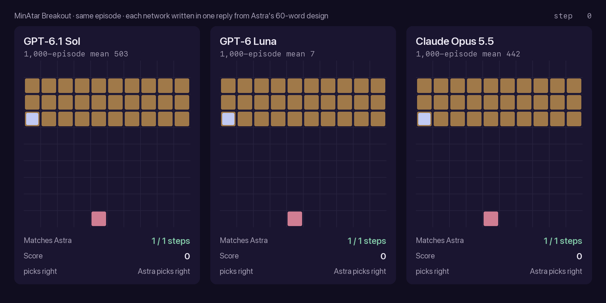
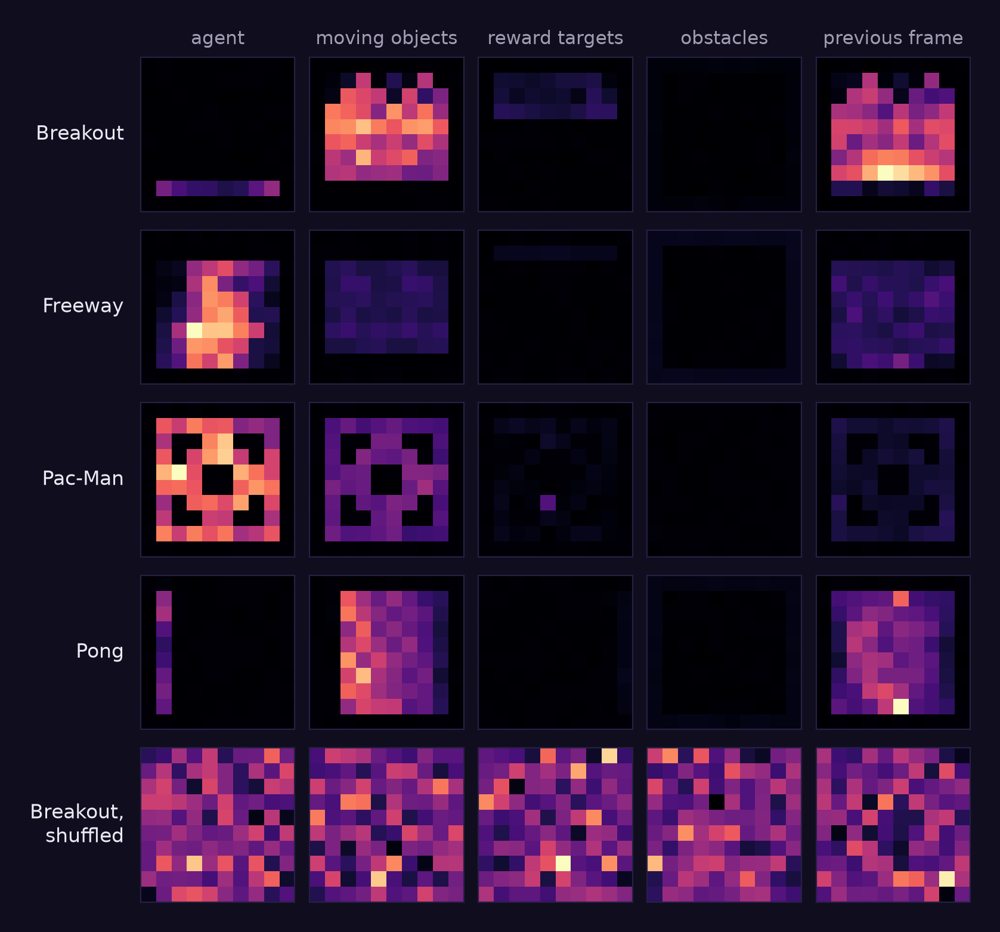
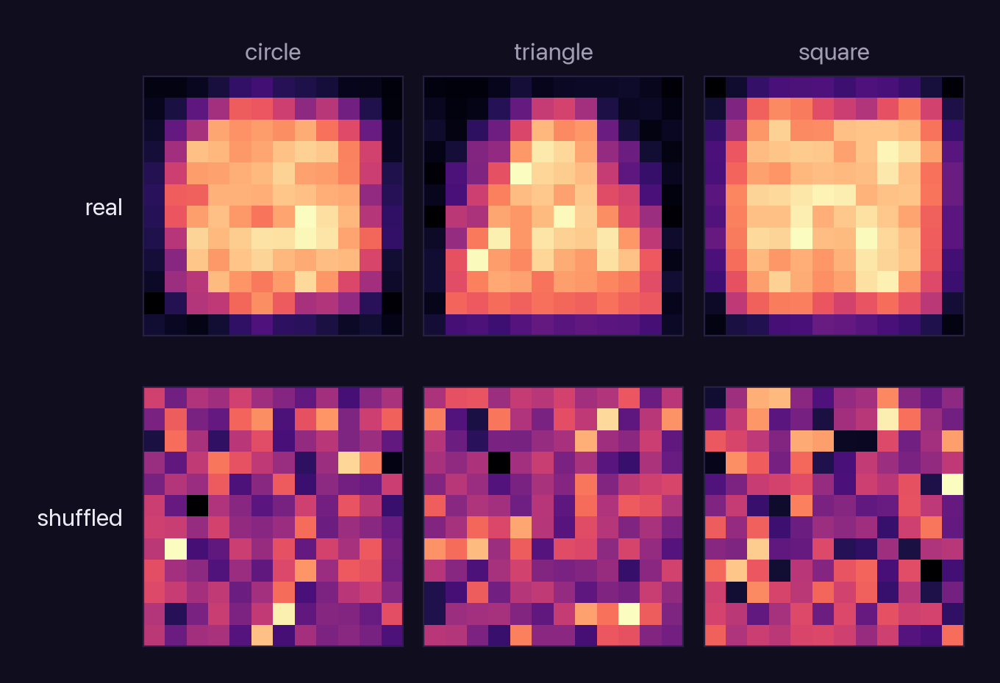

# [WSPlore] Follow-up Explorations of Weight-Space Programming

Follow-up experiments to *Sparks of Weight-Space Programming*: how well language models read and write
neural-network weights directly, without training.

In the original work (Takehi, Teoh, Zhang and Khattab, MIT CSAIL, November 2026), GPT-6 Astra names the task of a
network from its weights and writes working networks from scratch. The experiments here so far:

1. **Writing.** Astra writes a Breakout network that scores about 500. If other models are given Astra's own
   explanation of that network, taken from its answer, can they write it too, and where do they fail?
2. **Reading.** How much of the weight-reading result can a model get from a crude summary of one layer?



*Each network was written by the model in one reply, given the authors' Breakout prompt plus the explanation of the
design taken from Astra's own answer. Same episode, same seed. A red frame marks a step where the network's most likely move
differs from what Astra's network would do in that state.*

## Contents

- [Findings](#findings)
- [Writing weights: give the model Astra's own explanation](#writing-weights-give-the-model-astras-own-explanation)
- [Reading weights: the footprint baseline](#reading-weights-the-footprint-baseline)
- [Running it](#running-it)
- [Reproduction](#reproduction)
- [Acknowledgements](#acknowledgements)
- [Licence](#licence)

## Findings

### [1] Writing: Astra's own explanation of its network is enough for other models to rebuild it, move for move

- In the authors' logs, Astra's Breakout answer opens with a short explanation of its design (60 words), then gives
  the weights. We took that explanation out of the answer and added it to the authors' prompt. GPT-6.1 Sol (3 of 3
  runs) and Claude Opus 5.5 (1 of 1) then wrote networks that pick the same move as Astra's network in 99.6–100% of
  19,783 game states, and score 442–503 (Astra's network: 503).
- The weights are their own. At most 1 of the 85–131 weight statements in each answer is identical to one of
  Astra's.
- This crosses model families. Given nothing from Astra, Claude Opus 5.5 already arrives at the same design by itself
  (same move in 95% of states). Given Astra's explanation, it also stops running out of output: both runs finish,
  where two of three without it ran out of their 128k-token limit before writing any weights.
- Weaker models cannot use the explanation. GPT-6 Luna's networks pick Astra's move in 64–78% of states and still
  lose the ball after 60–220 steps on average (scores 0–14). Claude Opus 4.5 scores lower with the explanation than
  without it.
- Where a network differs from Astra's matters more than how often. Sol's own networks, written without Astra's
  explanation, pick Astra's move in only 78–79% of states and still score 378–480: in the 3,108 states where the ball
  is about to land, they always pick Astra's move.

### [2] Reading: naming a network's game needs only arithmetic, not understanding

- We replaced the weights in the authors' Experiment 1 prompt with one number per input: the mean absolute
  first-layer weight, laid out on the game's 10 × 10 grid. Claude Opus 4.5 names the game in 8 of 12 runs from this
  footprint, against 5 of 20 from the full weights (one-sided Fisher p = 0.025).
- The footprint works because it shows where the network looks: the bottom row for Breakout's paddle, the left
  column for Pong's, the maze for Pac-Man. Computed from shuffled weights it shows nothing, and Opus 4.5 falls to
  2 of 12 (p = 0.018). Claude Opus 5.5 names all four games from it.
- The shortcut has a limit. On Experiment 2 (which shape a generator draws), the per-pixel average gives no gain
  (6/9 against 8/15 from the weights), and Opus 4.5 calls the square a disc every time.

## Writing weights: give the model Astra's own explanation

The task is the authors' Experiment 5 on Breakout: write all 20,486 weights of a 600-32-32-6 tanh policy for
MinAtar Breakout in one reply, with no tools and no feedback. The network is scored over 1,000 episodes with sampled
actions and sticky actions (10,000-step cap). We add part of Astra's own answer to the prompt:

| Level | Prompt |
|---|---|
| L0 | The authors' prompt, unchanged |
| L1 | Plus the explanation that opens Astra's answer, 60 words ([specs/astra_breakout_strategy.txt](specs/astra_breakout_strategy.txt)) |
| L2 | Plus the layout of Astra's edits block with every value removed ([specs/astra_breakout_wiring.txt](specs/astra_breakout_wiring.txt)) |

The **same-move rate** of a network is the share of game states in which its most likely move (left, right or stay)
is the move Astra's network picks. The states are 19,783 states from 30 episodes of Astra's own play, every 10th
step. Moves other than left and right count as stay.

Breakout score per run, with the same-move rate in brackets:

| Model | L0 | L1 | L2 |
|---|---|---|---|
| GPT-6.1 Sol (n=3) | 480, 603, 378 (78%, 95%, 79%) | 503, 503, 503 (100% each) | 503, 503, 503 (100% each) |
| Claude Opus 5.5 | 336, –, – (95%)¹ | 442 (99.6%) | 456 (100%) |
| GPT-6 Luna (n=3) | 6, 0, 3 (21%, 15%, 17%) | 6, 7, 5 (74%, 78%, 78%) | 0, 14, 11 (28%, 73%, 64%) |
| Claude Opus 4.5 | 1.6, 10.7, 2.5, 1.3, 1.0 (21–35%)¹ | 0.5 (21%) | 0.1 (12%) |

¹ L0 runs from Turing's repository (same prompt). – = the model used its whole output limit before writing any
weights. Settings: Sol and Luna at reasoning effort `xhigh`, Opus 5.5 at `xhigh` with a 128k output limit, Opus 4.5
with a 48k thinking budget. Near 500, scores are limited by the 10,000-step cap: about half of the episodes of
Astra's network reach it ([weight-space-horizon](https://github.com/hamley241/weight-space-horizon)), so networks
in that range cannot be ranked by score.

**Same moves, own numbers.** All six Sol networks at L1 and L2 make Astra's move in all 19,783 states and in at
least 99.95% of the states of their own play, and score the same as Astra's network. Their weights are their own:
at L1, at most 1 of 85–91 statements is identical to one of Astra's. Opus 5.5 is a different developer's model, and
its one finished L0 network already has the same design: a landing-point prediction for each of the four directions
of travel, direction read from the ball and its trail, and gating in the second layer.

**Where the differences fall.** Same-move rate by game phase, on Astra's states (landing: the ball is falling and
in rows 6–8, 3,108 states):

| Network | Score | All states | Landing | Other |
|---|---|---|---|---|
| Sol, L0 run 1 | 480 | 78% | 100% | 74% |
| Sol, L0 run 3 | 378 | 79% | 100% | 75% |
| Opus 5.5, L0 | 336 | 95% | 100% | 94% |
| Luna, L1 run 1 | 6 | 74% | 98% | 70% |
| Luna, L1 run 2 | 7 | 78% | 73% | 78% |

Sol's L0 differences are design choices about where the paddle waits; it is always under the ball when it lands.
Luna can pick Astra's move at landing in Astra's states, where the paddle is already in place, and still lose every
ball in its own play: its earlier moves leave the paddle too far away.

**Why Opus 5.5 at L2 scores 456, not 503.** Its most likely move matches Astra's in all 19,783 states and in at least
99.95% of the states of its own play. The gap comes from its output layer: the logits are less extreme, so sampling
sometimes picks another move. Multiplying the output layer by 10, which changes no most likely move, gives 502.8, the
same as Astra's network. At L1 the same change gives 451.8, so that network also differs in a few moves (98% same moves
at landing). This check is a diagnosis; the reported scores are the networks as written.

Own-play states come from 10 episodes of up to 3,000 steps per network. Details are in
[runs/design/agreement.json](runs/design/agreement.json).

## Reading weights: the footprint baseline

A common critique of Experiments 1 and 2 is that the answer can be read off one layer: which inputs a policy network
uses tells you the game, without understanding what the network computes. To test this, we replaced the weights in
the authors' prompts with a footprint and kept everything else.

- **Experiment 1** (which MinAtar game does this policy play?): the mean absolute first-layer weight of each input
  over the 32 hidden units, as five 10 × 10 tables, one per input channel.
- **Experiment 2** (which shape does this generator draw?): the mean absolute last-layer weight of each output pixel
  over the 64 hidden units, as one 12 × 12 table.
- **Control**: the same tables computed from the shuffled weights.

The tables are given as numbers; the figures below draw them as maps (brighter is larger, each row on its own scale).





| | Raw weights (Turing) | Footprint | Footprint, shuffled |
|---|---|---|---|
| Exp 1, Claude Opus 4.5 | 5/20 | **8/12** | 2/12 |
| Exp 1, Claude Opus 5.5 | 12/12 | 4/4 | 0/4 |
| Exp 2, Claude Opus 4.5 | 8/15 | 6/9 | 0/9 |
| Exp 2, Claude Opus 5.5 | 8/9 | 3/3 | 0/3 |

- On Experiment 1, Opus 4.5 named Breakout and Freeway in 3 of 3 runs each, Pac-Man and Pong in 1 of 3. Pong was
  called Freeway twice. From raw weights it answers "Freeway" in 19 of 20 runs.
- On Experiment 2, Opus 4.5 named the circle and triangle in 3 of 3 runs and called the square a filled disc in all
  3. A likely reason: averaging over hidden units keeps where pixels vary, but not the shape each unit draws.
- We fixed how each outcome would be read before running. The two extra Opus 4.5 runs on Experiment 1 were added
  after the first run (3/4 against 5/20 was not significant); all runs are reported.

For Opus 4.5, then, Experiment 1 is easier from where the inputs are used than from the weights themselves, and a
correct answer on it is weak evidence that a model understands the computation. Experiment 2 is not solved this way.

## Running it

The code imports the harness of [weights_editing](https://github.com/alan-turing-institute/weights_editing): its
prompts, model calls, scorers, edits reader and Breakout evaluator. Clone both side by side:

```bash
git clone https://github.com/alan-turing-institute/weights_editing
git clone https://github.com/jasperzhao05/wsplore
cd wsplore && uv sync
```

API keys go in `weights_editing/.env` and model settings in `weights_editing/models.local.toml`, as described in
that repository.

```bash
uv run design.py --level L0 L1 L2 --dry-run                               # build the prompts only
uv run design.py --level L0 L1 L2 --models gpt-6.1-sol --reps 3
uv run agreement.py                                                       # same-move rates
uv run footprint.py --exp 1 --models claude-opus-4-5 --reps 3            # footprint prompts
uv run footprint.py --exp 1 --models claude-opus-4-5 --control shuffled
uv run figures.py                                                         # figures in assets/
```

| Path | Contents |
|---|---|
| `design.py` | Experiment 5 with part of Astra's answer added (L0–L2) |
| `agreement.py` | Same-move rate against Astra's network by game phase, on Astra's and each network's own states |
| `footprint.py` | Experiments 1 and 2 with footprint tables in place of the weights |
| `figures.py` | The figures and the animation |
| `specs/` | The parts of Astra's answer used at L1 and L2 |
| `prompts/` | The footprint prompt templates |
| `runs/` | Every run: the model's answer, the raw API response, settings, usage and scores |

Prompts that contain MinAtar's source code are not stored; `design.py` rebuilds them, and each run records the
prompt's SHA-256.

## Reproduction

Before the experiments above, we checked that the harness gives the published results. With
[weights_editing](https://github.com/alan-turing-institute/weights_editing) (commit `96aff8f`), one run per
network:

| | Authors: GPT-6 Astra | Claude Opus 5.5 | GPT-6.1 Sol |
|---|---|---|---|
| Exp 1: name the game (4 networks) | 4/4 | 4/4 | 4/4 |
| Exp 1, shuffled weights | | 0/4 | 1/4 |
| Exp 2: name the shape (3 networks) | 3/3 | 3/3 | 3/3 |
| Exp 2, shuffled weights | | 0/3 | 0/3 |

Astra's released Breakout network scores 502.9 ± 7.7 with this harness over 1,000 episodes (published: 517). The
runs are in [runs/reproduction/](runs/reproduction/). The Turing repository has the full replication, with more runs
and models.

## Acknowledgements

- Rikiya Takehi, Jayden Teoh, Alex Zhang and Omar Khattab (MIT CSAIL), *Sparks of Weight-Space Programming: LLMs can
  natively read & write neural network weights*, 2 November 2026:
  [blog](https://rikiyat.github.io/blog/weight-space-programming/), [logs](https://github.com/RikiyaT/lm_understand-logs).
  The experiments, prompts, networks and Astra's answers are theirs.
- The Alan Turing Institute, [weights_editing](https://github.com/alan-turing-institute/weights_editing): the harness
  this repository runs on, and the Claude Experiment 5 runs used here as L0.
- K. Young and T. Tian, *MinAtar: An Atari-Inspired Testbed for Thorough and Reproducible Reinforcement Learning
  Experiments*, 2019 ([arXiv:1903.03176](https://arxiv.org/abs/1903.03176)).
- [weight-space-horizon](https://github.com/hamley241/weight-space-horizon), for the step-cap analysis of Astra's
  Breakout network.

## Licence

The code is under the MIT License. The parts of Astra's answer in `specs/` come from the authors' logs and are under
CC BY 4.0; `specs/astra_breakout_wiring.txt` is Astra's edits block with every value removed. The model outputs in
`runs/` are released under CC BY 4.0 as far as we hold any rights in them. See [LICENSE](LICENSE).
